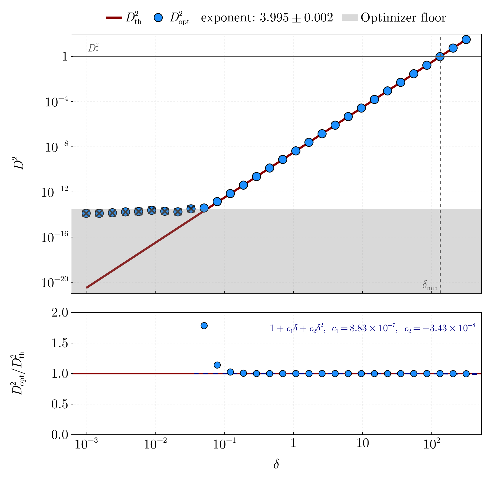
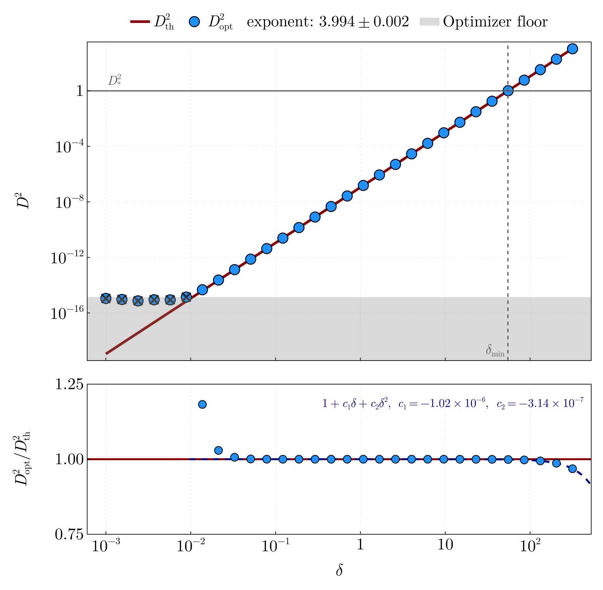

# CurvatureDistinguishability.jl

[](https://PaulGoG.github.io/CurvatureDistinguishability.jl/stable/)
[](https://github.com/PaulGoG/CurvatureDistinguishability.jl/actions/workflows/CI.yml?query=branch%3Amain)
[](https://codecov.io/gh/PaulGoG/CurvatureDistinguishability.jl)
[](https://github.com/JuliaTesting/Aqua.jl)
[](https://github.com/aviatesk/JET.jl)
[](https://github.com/PaulGoG/CurvatureDistinguishability.jl/actions/workflows/Format.yml?query=branch%3Amain)
[](https://julialang.org/downloads/)

Numerical verification of the quartic distinguishability law for space-based
gravitational-wave interferometry. The squared noise-weighted distance
between a two-source signal and the best-fit single-source template scales as

```math
D^2 \approx \frac{1}{16}\,K(u)\,\delta^4 ,
```

where $`\delta`$ is the parameter separation along the unit direction $`u`$
and $`K(u)`$ the extrinsic curvature of the signal manifold. The
discernibility boundary follows as

```math
\delta_{\min}(u) = \left(\frac{16\,\rho_{\mathrm{thr}}^2}{K(u)}\right)^{1/4} .
```

The 2D "zone of confusion" maps are the intersection of that boundary with
the hard physical parameter bounds: non-negative distance, chirp mass and
coalescence time, $`|\chi| \le 1`$, phase deviations within $`\pm\pi`$.

## At a glance

Both figures are sweeps of the production configuration
(`configs/production_cpu.toml`: a one-year observation on a grid of
$`1.57\times10^{6}`$ frequency bins, thirty separations per direction).
`scripts/replot.jl` regenerates them from a run's tables; the minutes-scale
`configs/quickstart.toml` shows the same law on a short grid.



*Quartic law along the six-dimensional diagonal direction of a distant
moderate-mass binary, every shape parameter displaced at once: the optimized*
$`D^2`$ *follows* $`\tfrac{1}{16}K(u)\,\delta^4`$ *over fifteen decades above
the optimizer floor (exponent 3.995 ± 0.002); the strip beneath shows the
ratio to the prediction with its* $`\mathcal{O}(\delta^5)`$ *correction fit.*



*The chirp-mass/coalescence-time direction of a massive aligned-spin binary,
the degeneracy that dominates realistic catalogues: exponent 3.994 ± 0.002,
discernibility scale* $`\delta_{\min} = 55`$ *Fisher* $`\sigma`$, *and the
onset of the crossover to resolution at the largest separations.*

## File structure

```text
CurvatureDistinguishability/
├── Project.toml        # dependencies, GPU weak dependencies, [compat]
├── activate.jl         # activates and instantiates the package environment
├── configs/            # TOML scenarios: quickstart*, production_*, pn_orders/, campaigns/; figures/ layouts
├── src/                # library: physics, geometry, inference, orchestration, plotting
├── ext/                # GPU package extensions (CUDA, AMDGPU, Metal, oneAPI)
├── scripts/            # entry points: run_pipeline, run_supervised, launch_run, replot,
│                       #   collect_plots, compose_figures
├── test/               # unit, physics-validation, static-QA and end-to-end tests
├── bench/              # BenchmarkTools suite (own environment)
├── docs/               # Documenter.jl sources (own environment); src/assets/ holds the README figures
├── data/               # run outputs, one run_<hash>/ per run (git-ignored)
└── plots/              # figure exports of collect_plots and compose_figures (git-ignored)
```

The full annotated tree is in [Full file tree](#full-file-tree) below.

## Environment setup

Julia ≥ 1.13 (`[compat]`), installed through `juliaup`. `Manifest.toml` is not version-controlled.
Each environment resolves on first activation, and every run directory
receives a copy of the resolved manifest for provenance.

Each environment ships a pure-Julia activation script that activates and
instantiates it silently. Every script that loads the package includes the
activation script of its environment, so no `--project` flag is needed.
`julia -i` on a script opens a REPL in its environment:

```bash
julia -i activate.jl        # package environment
julia -i docs/activate.jl   # documentation environment (package by path)
julia -i bench/activate.jl  # benchmark environment (package by path)
julia -i test/activate.jl   # test sandbox through TestEnv.jl (installed into a shared environment on first use)
```

To use the package as a library from another environment (unregistered):

```julia
Pkg.add(url = "https://github.com/PaulGoG/CurvatureDistinguishability.jl")
```

GPU support is optional. Install the vendor package matching the hardware
(`CUDA`, `AMDGPU` or `oneAPI`) into the default (stacked)
environment. The pipeline loads it according to `[hardware].gpu_backend`,
and the matching package extension activates. With `gpu_backend = "auto"`
and no functional GPU the pipeline runs on the multi-threaded CPU backend;
`"none"` forces the CPU. A backend named explicitly that is not installed or
not functional stops the run with a configuration error.
`[hardware].require_gpu = true`, set in every shipped GPU overlay, stops a
run before any result is written when no functional GPU backend resolves.
Configuration layering, run identity and the execution defaults are
described in the documentation page `docs/src/parameters.md`.

## Entry points

```bash
# main pipeline, foreground; without --config the minutes-scale configs/quickstart.toml runs
julia --threads=auto scripts/run_pipeline.jl --config configs/production_cpu.toml

# supervised run(s): hang detection, continuation in a new process, retry budget;
# re-running the same command continues what is unfinished
julia scripts/run_supervised.jl configs/production_gpu.toml configs/production_cpu.toml

# the same, detached from the terminal (console output in data/logs/)
julia scripts/launch_run.jl configs/production_gpu.toml configs/production_cpu.toml

# continue an interrupted unsupervised run instead of starting run_<id>_rN
julia --threads=auto scripts/run_pipeline.jl --config configs/production_cpu.toml --resume

# regenerate every figure of a finished run from its CSVs; --rho R rescales maps and
# threshold markers to another discernibility threshold without recomputation
julia scripts/replot.jl data/run_<hash> [--rho R] [--refit]

# multi-panel publication composites from persisted run tables, laid out by a TOML file
# (the example layout reads the quickstart run data/run_027b0820; output in plots/)
julia scripts/compose_figures.jl configs/figures/quickstart_composites.toml [--output-dir DIR] [--print-width PT]

# render all figures of one or more runs as a flat PNG view (plots/ by default)
julia scripts/collect_plots.jl [dest_dir] [run_id ...]

# test suite (unit, physics validation, static QA, end-to-end); a subset by group:
# Pkg.test(test_args = ["physics", "geometry"])
julia -e 'include("activate.jl"); Pkg.test()'

# benchmarks (own environment; the package resolves by path)
julia --threads=auto bench/run_benchmarks.jl

# documentation build, strict mode (own environment)
julia docs/make.jl
```

Everything tunable lives in the `configs/` scenario files: grid, physics,
the full Robson et al. (2019) noise model (confusion and instrumental parameters
alike), mapping resolution/refinement, `[parameter_bounds]`, optimizer and
`[safety]` memory budgets. `[monitoring].enabled = true` additionally prints
an in-terminal UnicodePlots diagnostic after each completed sweep and map.
It does so in TTY sessions only; detached logs stay clean.

The configuration is validated up front. Unusable values and unknown keys
abort with an error naming the offending key. Suspicious values warn.

Each run lands in `data/run_<confighash>/`. The directory holds a config
snapshot, `metadata.toml` (git commit, backend, timings), `hardware.txt`, a
copy of the resolved `Manifest.toml`, per-sweep work-item checkpoints
(`checkpoint.csv`) and a structured, ANSI-free `run.log`. Reruns get
suffixed directories and `safesave`-style backups, so results are never
overwritten.

`scripts/run_pipeline.jl` exits with status

- 0 when every stage completed;
- 2 when nothing was computed: a configuration or resource-budget error, a
  required GPU that is missing, or a run directory that another process
  holds or another package version produced;
- 3 when one or more stages failed. The other stages still run and the failed
  ones are listed under `failed_stages` in `metadata.toml`. If the GPU stops
  responding after a failed sweep, the remaining sweeps and the maps are left
  to a new process (`--resume`, or the supervisor);
- 1 on any other error.

## Outputs

- 1D sweeps write to `sweeps/<name>/`:
  - `results.csv`: per-separation $`D^2`$, best-fit parameters, convergence
    diagnostics, active-bound flags and multi-start gain.
  - `residual_spectrum.csv`: the decimated residual spectrum the residual
    plot is drawn from.
  - `sweep_meta.toml`: fitted log-log slope ± standard error over all clean
    points (`slope`) and over the perturbative window (`slope_window`). It
    also holds the coefficients $`c_1`$, $`c_2`$ of the
    $`\mathcal{O}(\delta^5)`$ correction with its 10 % validity radius, the
    optimizer floor level, $`\delta^*`$ and `amp_ratio`. The coefficients are
    fitted on the points within `correction_fit_max_departure` of the law.
  - `scaling_plot.{pdf,png}`: log–log panel plus a
    $`D^2_{\mathrm{opt}}/D^2_{\mathrm{th}}`$ ratio panel with the
    correction-fit overlay.
  - `residual_plot.{pdf,png}`: the densities
    $`\mathrm{d}\rho^2/\mathrm{d}f`$ and $`\mathrm{d}D^2/\mathrm{d}f`$ for
    channels A and E. The bottom panel integrates to $`D^2`$.
  - `residual_spectrum_threshold.csv` and
    `residual_plot_threshold.{pdf,png}`: the same at the swept separation
    whose $`D^2`$ is nearest $`\rho_{\mathrm{thr}}^2`$, close to
    $`\delta_{\min}`$, written when it differs from the primary evaluation
    point.
  - `sweep.log`: the stage log.

  Sweeps support unequal amplitudes (`amp_ratio`, with the harmonic-mean
  prefactor of the law) and opt-in multi-start seeding (`n_starts`, seeded
  by `[pipeline].rng_seed`).
- 2D maps write to `maps/<name>/`:
  - `confusion_contour.csv`: angle, capped boundary,
    `R_Math`/`R_Box`/`Prior_Limited`/`Degenerate` columns, $`K`$ and $`g`$.
  - `confusion_zone.{pdf,png}`: prior-limited boundary segments (wall
    color, active wall values annotated) are visually distinct from
    curvature-limited ones. The uncapped mathematical contour continues
    past each wall as a dashed curve.
  - `mapping.log`: the stage log.

  Directions are sampled uniformly in the Fisher-normalized plane (each axis
  in its own $`\sigma`$), so strongly anisotropic planes are resolved
  uniformly. $`K`$ is computed on $`[0, \pi)`$ only and mirrored, since
  $`K(u) = K(-u)`$. Angular refinement is adaptive near boundary spikes.

## Status of components

| Component | Status |
|---|---|
| Physics / Detector / Geometry / Inference | unit-tested; regression-locked against the committed reference fixtures |
| TaylorF2 phase through 4.5PN (`[physics].phase_pn_order`) | 1.5PN by default; every coefficient tested against 60-digit evaluations of the literature forms at five points; tangent rank tested against its analytic prediction; comparison overlays in `configs/pn_orders/` |
| Fit in whitened coordinates (`[pipeline].fit_coordinates = "whitened"`) | tested against the curvature prediction at 1.5PN and 2PN, and against the full whitened Jacobian on a weakly constrained point |
| Robson (2019) noise model (per-channel Eq. 12 instrumental + Eq. 14 confusion through the Eq. 9 response, Table 1) | active by default; `[noise].confusion_enabled = false` for instrumental-only studies |
| Box-constrained optimization (`IPNewton`; `lbfgs_box` fallback) | tested, physical bounds enforced |
| 2D mapping (mirrored, prior-capped, adaptively refined) | tested end-to-end |
| GPU path (KernelAbstractions kernel + package extensions) | validated against the CPU reference on CUDA, ROCm and oneAPI hardware: optimized distances agree to $`3\times10^{-4}`$ or better above the optimizer floor, $`2\times10^{-4}`$ away from the near-null spin direction; see Known limitations |
| Plotting (CairoMakie publication theme, family-wide tick policy) | tested; figures regenerable via `scripts/replot.jl` |
| Multi-panel composites (TOML layout over persisted run tables) | tested; `scripts/compose_figures.jl` |

## Known limitations

- Phase orders above 1.5: the spin combination that the higher orders
  constrain is constrained weakly, so sweeps need
  `[pipeline].fit_coordinates = "whitened"` (the fit in the parameters stalls
  on it). The long axis of the spin-plane confusion zone is not converged in
  post-Newtonian order for sources that reach high velocities in the band; the
  documentation (Waveform Physics, §2) compares the orders.
- Apple GPUs: Metal has no double-precision type and the device path is
  double precision only, so the Metal extension declines. With
  `gpu_backend = "auto"` the run uses the CPU; `"metal"` or
  `require_gpu = true` stops it.
- ROCm 7.1 on gfx1100/gfx1101 (Radeon PRO W7900, RX 7700 XT): a kernel
  dispatch intermittently never completes; the process stays alive at
  near-zero CPU load with no error. Unresolved upstream; run long GPU
  campaigns on these devices under `scripts/run_supervised.jl`, which ends
  the stalled process and continues the run.
- Intel integrated GPUs driven by i915: the kernel resets the compute
  context when a single launch exceeds the engine preempt timeout (7.5 s by
  default). `hessian_chunk = 2` keeps launches well below it on the shipped
  grids; `hessian_chunk = 3` is marginal on the production grid and fails on
  longer grids, and `hessian_chunk = 0` exceeds the device's 2048-byte
  kernel-argument limit.
- Hosts with an integrated GPU beside a discrete one: restrict device
  visibility (`CUDA_VISIBLE_DEVICES`, `ROCR_VISIBLE_DEVICES`/
  `HIP_VISIBLE_DEVICES`, `ZE_AFFINITY_MASK`) so the discrete device is
  selected; the `backend` line of `metadata.toml` names the device in use.
- The signal fills the frequency band whatever its emission time unless
  `[physics].observation_window = true`; for light systems the band below
  the frequency radiated at $`t = 0`$ then holds decades of inspiral from
  before the observation (documentation, Waveform Physics, Finite observation).

## How to cite

Citation metadata is in `CITATION.cff`; a BibTeX entry:

```bibtex
@software{Gogita_CurvatureDistinguishability,
  author  = {Gogîță, Paul-Adrian},
  title   = {CurvatureDistinguishability.jl},
  version = {2.3.0},
  year    = {2026},
  url     = {https://github.com/PaulGoG/CurvatureDistinguishability.jl}
}
```

## Full file tree

<details>
<summary>Annotated tree</summary>

```text
CurvatureDistinguishability/
├── Project.toml            # deps, GPU weakdeps + extensions, compat
├── activate.jl             # silent activation of the package environment (included by the scripts)
├── configs/
│   ├── quickstart.toml     # base: minutes-scale demonstration run (the default)
│   ├── quickstart_gpu.toml # [hardware] overlay: quickstart on the GPU path
│   ├── production_cpu.toml # base: CPU reference campaign configuration
│   ├── production_gpu.toml # [hardware] overlay: GPU baseline (auto backend, chunk 2)
│   ├── pn_orders/          # overlays at each phase order: quickstart, production spin maps
│   ├── quickstart_maps.toml   # overlay: nine-map verification on the quickstart grid
│   ├── campaigns/          # multi-host benchmark campaign as run (own frozen bases)
│   └── figures/
│       └── quickstart_composites.toml  # composite-figure layout on the quickstart run
├── src/
│   ├── CurvatureDistinguishability.jl  # top module, exports
│   ├── Backends.jl         # backend registry; CPU fallback; GPU via extensions
│   ├── Physics.jl          # Robson (2019) noise model; inspiral waveform core (TaylorF2 phase to 4.5PN)
│   ├── Detector.jl         # LISA A/E response on the analytic orbits (fused scalar core)
│   ├── Residuals.jl        # residual-spectrum diagnostics (d(SNR²)/df densities)
│   ├── Bounds.jl           # physical parameter bounds, deviation boxes, ray–box crossings
│   ├── Geometry.jl         # tangent basis (MGS), fused directional derivatives, prior capping
│   ├── Fitting.jl          # shared fit statistics: slope, O(δ⁵) fit, floor rule
│   ├── Inference.jl        # box-constrained D² optimization; KA loss kernel; whitened-coordinate fit
│   ├── Config.jl           # validated TOML configuration (hard-fail guardrails)
│   ├── Provenance.jl       # config-hash run IDs, snapshots, safesave, metadata; run-directory locks, per-attempt records
│   ├── Plotting.jl         # CairoMakie figures; family-wide tick policy
│   ├── Heartbeat.jl        # worker liveness counter and heartbeat file
│   ├── Supervision.jl      # process watchdog: CPU/progress hang detection, retry budget
│   ├── Checkpoint.jl       # durable per-separation sweep checkpoints
│   ├── ZoneSampling.jl     # map sampling geometry: Fisher-scaled directions, refinement, prior walls, mirroring
│   ├── Orchestrator.jl     # pipeline driver: sweeps, capped mirrored mapping
│   ├── Campaign.jl         # supervised execution of pipeline configurations
│   └── RunFigures.jl       # figure regeneration from persisted run CSVs
├── ext/                    # GPU package extensions, one per vendor package
│   ├── CurvatureDistinguishabilityCUDAExt.jl
│   ├── CurvatureDistinguishabilityAMDGPUExt.jl
│   ├── CurvatureDistinguishabilityMetalExt.jl
│   └── CurvatureDistinguishabilityoneAPIExt.jl
├── scripts/
│   ├── run_pipeline.jl     # CLI entry point (loads GPU package per config)
│   ├── run_supervised.jl   # supervisor entry point (one or more configurations)
│   ├── launch_run.jl       # detached launcher of run_supervised.jl
│   ├── replot.jl           # regenerate all figures from a run's CSVs
│   ├── collect_plots.jl    # flat PNG browsing view of one or more runs
│   └── compose_figures.jl  # multi-panel composites from a TOML layout over run tables
├── test/
│   ├── runtests.jl         # runs the test groups below, all or those named in test_args
│   ├── common.jl           # fixture grid and physical setup shared by the groups
│   ├── qa.jl, physics.jl, geometry.jl, inference.jl, config.jl,
│   │   fitting_plotting.jl, orchestrator.jl, e2e.jl  # one file per group
│   ├── supervision_tests.jl  # watchdog, checkpoint and continuation tests
│   ├── Project.toml
│   ├── activate.jl         # interactive test sandbox via TestEnv.jl
│   └── fixtures/
│       ├── generate_reference.jl  # regenerates the golden values from the current model
│       └── reference/      # committed golden-value regression fixtures
├── bench/                  # BenchmarkTools scripts (own environment: activate.jl)
├── docs/                   # Documenter.jl sources (own environment: activate.jl, make.jl, src/)
├── .github/
│   ├── workflows/CI.yml    # tests on the declared Julia floor, the current stable and the lowest compatible dependencies; strict docs build and deployment
│   ├── workflows/Format.yml # JuliaFormatter check
│   ├── dependabot.yml      # weekly GitHub Actions and Julia dependency updates
│   ├── ISSUE_TEMPLATE/     # bug report, feature request
│   └── PULL_REQUEST_TEMPLATE.md
├── .gitignore
├── .JuliaFormatter.toml    # formatter configuration, enforced by CI
├── CHANGELOG.md
├── CITATION.cff
├── CONTRIBUTING.md
├── LICENSE                 # MIT
├── README.md
├── data/
│   ├── run_<hash>/         # provenance-stamped pipeline runs (git-ignored)
│   └── logs/               # detached-launch console logs (git-ignored)
└── plots/                  # collect_plots PNG view and compose_figures composites (git-ignored)
```

</details>
